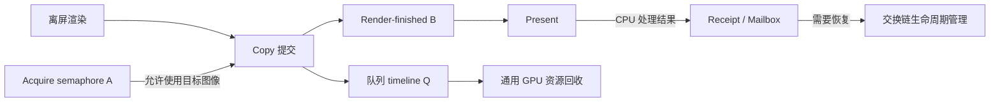

# Vulkan Swapchain 与 Present 的逻辑模型演进

本轮探索围绕一个问题展开：**一次 Present 究竟需要管理哪些工作，它们是否必须共享同一个生命周期？**

最终模型将职责分为三部分：交换链负责图像的获取与交还，通用队列负责 Copy 的提交与资源回收，窗口呈现对象负责重建和释放。这个划分来自对原有“逐次呈现任务”模型的逐步拆解。

## 1. 初始模型：以一次呈现任务为单位管理资源

原模型为一次 Present 关联 Copy context、源纹理、交换链引用和呈现完成记录，并通过固定 `PresentSlot` 保存 fence、ticket 和复用代际。资源退休需要同时满足 GPU 与 WSI 两方面的条件。

这里的 WSI（Window System Integration）是 Vulkan 与窗口呈现系统的接口。GPU 将像素写入交换链图像后，呈现系统还要使用该图像及相关同步对象，因此 GPU 提交完成与呈现资源可释放具有不同边界。

```text
一次呈现任务
  ├─ GPU 工作：Copy 命令、源纹理、命令上下文
  └─ WSI 工作：交还交换链图像、消费呈现等待 semaphore
             ↓
       跟踪完成并退休任务
             ↓
       释放引用、归还 slot
```

这个模型便于表达“这次呈现是否已经全部处理完”，但也引入两个耦合：

- **回收耦合**：Copy context 和源纹理只需要活到 Copy 完成，却可能随呈现记录保留更久。
- **限流耦合**：slot 既保存完成状态，又通过“等待旧 slot 才能复用”限制后续呈现。

交换链图像与 slot 也不是同一类对象。图像按 Acquire 返回的 image index 使用；slot 按呈现任务分配。增加 slot 不会增加可用图像，图像数量也不能直接回答需要保留多少条 CPU 完成记录。

最初将并行数组整理为 `SwapchainImage` 和 `PresentSlot`，使这种职责差异显式化，也为后续拆分提供了依据。

## 2. 第一次改进：按资源的完成条件拆分回收

第一步保留逐次呈现跟踪，但将 Copy 资源从 WSI 记录中剥离：

```text
Copy 提交完成 ──→ 归还 context，释放源纹理及延迟释放项
WSI 释放条件 ──→ 结束轻量呈现记录，归还 Present fence
```

随后用动态 fence 池和轻量记录替代固定 slot 环。这样不再为了复用某个 slot 阻塞后续呈现，尚未满足释放条件的记录也不再占用 Copy context。

这一阶段明确了几个同步对象的不同含义：

| 同步对象 | 建立的关系 | 能支持的回收判断 |
| --- | --- | --- |
| Acquire semaphore A | 呈现系统 → 使用交换链图像的 GPU 提交 | 包含该 wait 的提交完成后，可以复用 A |
| Render-finished semaphore B[i] | 最后写入图像的 GPU 提交 → Present | 呈现可以读取图像；它本身不通知 CPU 何时回收 |
| 队列 timeline Q | GPU 提交 → Completion，也可建立跨队列依赖 | 回收该提交的命令资源和引用 |
| Present fence | 带 maintenance1 扩展的 Present → CPU | 达到扩展规定的呈现资源释放条件，不代表像素已经显示完毕 |

当前路径的最后一次写入是 Copy，因此 B 在这里也可以理解为 copy-finished。保留 render-finished 命名，是因为它表达的是“该图像最后的 GPU 写入完成”，不依赖写入采用渲染还是复制。

### 按图像复用 semaphore，减少额外的完成状态

B 的生命周期与交换链图像关联，因此每张图像持有一个 B。再次 acquire 同一图像，并完成对本次 A 的等待后，可以安全复用上一轮的 B。**只取得 image index 不足以建立这个条件。** [Vulkan Guide：交换链 semaphore 复用](https://docs.vulkan.org/guide/latest/swapchain_semaphore_reuse.html)

中间方案还利用这一条件结束兼容路径的上一轮呈现记录：图像保存旧 ticket，本次 Copy 完成后退休旧记录。但最后一轮图像可能不再被 acquire，重建和关闭仍需要另一种处理方式。

因此，这一步缩短了资源生命周期，却仍保留了两套逐次管理：GPU 完成包，以及 WSI 的记录、查询和 drain（等待指定记录结束）。

## 3. 路径探索：交换链图像应进入哪一层

Copy / Direct 的核心差异，是**交换链 acquisition 的生命周期从哪里开始**。

| 路径 | 逻辑链条 | 对上层的影响 |
| --- | --- | --- |
| Copy | 渲染到离屏输出 → Acquire → Copy → Present | 交换链图像只进入最终提交阶段 |
| Direct | Acquire → 最终输出写入交换链图像 → Present | 渲染流程必须持有本次取得的图像及其同步状态 |

Direct 省去末尾 Copy，但需要将“已取得、尚未交还”的图像状态跨越帧准备、录制和提交阶段传递。实验中的 `VulkanSwapchainFrame` 因此保存图像索引、acquire 同步对象、交换链引用，以及 wait、signal、present 和退休状态。帧取消或重建时，也必须处理已取得却未呈现的图像。

这说明 Direct 的成本不限于增加一个分支：它扩大了必须理解交换链生命周期的代码范围。控制台切换同样需要处理这些资源状态，不能消除这部分复杂度。

最终保留 Copy，让离屏渲染继续围绕普通纹理组织，把 acquisition 集中在提交末端。代价是一次全图 Copy 和离屏输出存储，收益是上层无需持有 acquired image。这里的取舍以现有渲染架构的简洁性为主；Direct 仍可能适合更重视复制带宽或不同调度方式的场景。

较早与较晚 Acquire 还会改变背压发生的位置，但端到端时延同时受输入采样、队列深度和 present mode 影响，不能仅从是否有 Copy 推导。

## 4. 第二次改进：把 Present Copy 还原为普通 GPU 工作

保留 Copy 后，下一个问题是：它是否需要专用 context 和专用完成包？

Copy 确实需要 command pool、command buffer、状态记录和输入引用，但这些与普通命令提交的资源需求一致。专用 `VulkanPresentContext` 和 `VulkanPresentCompletionBatch` 重复了队列已有的录制、池化和退休机制。

于是将 Copy 接入通用路径：

```text
普通 VulkanCommandContext
  → CurrentVulkanRecordedSubmit
  → SubmitRecorded
  → VulkanSubmitCompletionBatch
  → Completion 等待队列 timeline，重置并归还 context
```

每次 Copy 借用池中的 context，不代表每次重新分配原生对象。**池化决定资源从哪里取得，完成跟踪决定资源什么时候可以再次使用。** 因此可以删除专用 Present context，却仍需要通用队列 timeline。UE 普通 payload 通过队列完成机制回收的方式，也提供了这一方向的参考。

Copy 所在的提交同时包含两类 signal：B 供 Present 等待，Q 的值 `v` 供普通 Completion 回收。Q 是队列已有的 timeline，不是为每次 Present 创建的同步对象。

这一合并仍需保持两个边界：

- **CPU 发出 Present 前，保留输入引用。** 当前实现先提交 Copy，暂缓发布 Completion 包，发出原生 Present 后再交给 Completion，避免 GPU 很快完成时引用被提前释放。
- **Copy 提交结果与 Present 结果独立。** Copy 已提交后，即使 Present 要求重建，命令资源仍必须等 Q 到达 `v` 才能正常回收。

到此，专用 GPU 呈现通道已经消失；剩余的专用机制只有逐次 WSI 完成跟踪。

## 5. 第三次改进：把 WSI 清理移到交换链生命周期边界

轻量呈现记录继续存在的理由，是异步判断呈现资源何时可以释放，并支持只等待某一批呈现记录。为此，它必须持有交换链引用，维护完成状态，并处理不会再次 acquire 的尾部记录。

最终选择放弃这一级精细跟踪：正常帧依靠交换链图像的 acquire/reuse 顺序，重建或释放时统一收拢此前工作。

```text
正常帧
  Acquire → Copy → Present
  Copy 资源由通用 Completion 回收

交换链重建 / 释放 / 后端关闭
  停在有序生命周期边界
    → 排完此前提交
    → 等待普通 GPU 完成与 CPU 回收结算
    → device idle
    → 重建或释放交换链资源
```

因此删除逐次 Present fence、WSI 完成记录、ticket 和定向 drain。`PresentationSurface` 继续长期持有交换链，在生命周期边界同步；普通 Copy 完成包只持有它完成自身工作所需的引用。

这个选择将代价从“每次 Present 管理独立完成状态”转为“重建与释放时使用较粗等待”。普通帧不调用 device idle；已有 frame timeline 和交换链图像的可获取性仍约束工作推进，删除 slot 不等于取消全部在途限制。

**边界上的简化有明确代价。** 不带相关扩展的 `vkDeviceWaitIdle` / `vkQueueWaitIdle`，不能提供与 Present fence 等价的交换链呈现资源释放保证。当前采用传统的 WaitIdle 后清理策略；若要求严格的 WSI 释放保证或更细粒度的重建，就需要重新引入相应扩展支持。[Khronos 对 WaitIdle 清理边界的说明](https://docs.vulkan.org/guide/latest/swapchain_semaphore_reuse.html#_vk_ext_swapchain_maintenance1_extension)

所以，这一步改变了应用的清理策略，并没有把“GPU 完成”重新定义为“WSI 完成”。[maintenance1 的 Present fence](https://docs.vulkan.org/refpages/latest/refpages/source/VkSwapchainPresentFenceInfoKHR.html) 仍具有独立的资源释放语义。

## 6. 最后补齐：把请求结果与 GPU 工作状态分开

合并提交流程后，Present 也会预留通用队列的逻辑值。但 Acquire 可能返回 Retry 或要求重建，本次根本没有 Copy 提交。于是，“请求已经处理”与“GPU 已完成某个提交”也必须分开。

| 实际状态 | 正确处理 |
| --- | --- |
| 未提交 Copy，结果可恢复 | 取消本次逻辑值，结算 CPU 处理；队列继续可用 |
| Copy 已提交，Present 成功或需要恢复 | 按真实 GPU 完成点回收 Copy；另行反馈呈现结果 |
| 设备发生故障 | 进入队列故障处理，不能伪造成功完成 |

曾经的分类只将 `Rejected` 视为可恢复，导致未提交的 `Retry` / `Recreate` 把整个 timeline 对象标为失败。模型修正后，这些结果只执行 `Reject(v)`；设备故障才执行 `Fail()`。后续 GPU 可以 signal 更大的值，无需用 host signal 把跳过的值伪装成成功工作。未提交包通过 CPU retirement serial 结算。

同理，`PresentReceipt` 和 `PresentFeedbackMailbox` 继续保留：它们告知窗口管理方是否重试、重建交换链或重建 surface，不承担 GPU/WSI 资源退休。反馈附带 epoch 和 drawable generation，旧请求的失败不能使新交换链失效。

## 7. 最终模型：每种状态只回答一个问题



A、B、Q 对应三条不同的依赖。A 和 B 是 WSI 接口使用的 binary semaphore，Q 负责通用队列完成，不能直接替换它们。Acquire 返回确定目标图像，GPU 等待 A 后才能使用；源纹理的像素在 Copy 执行时读取，Acquire 不会生成像素快照。

最终的职责边界为：

| 管理范围 | 保留的状态 | 回答的问题 |
| --- | --- | --- |
| 交换链图像 | image、view、按图像分配的 B | 本次使用哪张图像，呈现何时可以读取？ |
| 普通 GPU 提交 | context、输入引用、队列 timeline、Completion 包 | 命令何时完成，资源何时可以复用？ |
| 呈现请求反馈 | receipt、恢复 mailbox | 请求得到什么结果，窗口侧需要做什么？ |
| 交换链生命周期 | surface 身份、epoch、长期引用和同步边界 | 何时重建或释放这一代交换链？ |

本轮改进逐步消除了“完整呈现任务”对其他资源生命周期的统管：GPU 资源回到通用提交模型，呈现结果回到窗口恢复模型，交换链清理回到生命周期模型。保留的同步关系由真实资源依赖决定。

代码对应：[交换链](../source/runtime/render/rhi/vulkan/VulkanSwapChain.h)、[提交与回收](../source/runtime/render/rhi/vulkan/VulkanQueue.cpp)、[生命周期与恢复](../source/runtime/render/renderer/common/PresentationSurface.cpp)。
